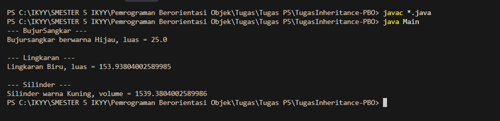

# TugasInheritance-PBO

## Deskripsi Konsep PBO dalam Kode

Berikut adalah penjelasan mengenai bagaimana tiga konsep utama PBO diterapkan dalam program ini:

### 1. Encapsulation (Enkapsulasi)
Enkapsulasi adalah konsep menyembunyikan detail implementasi data dari akses langsung, sehingga data hanya bisa dimodifikasi melalui metode yang telah ditentukan (seperti *getter* dan *setter*).
*   **Penerapan dalam kode:** Pada kelas `BujurSangkar`, atribut `sisi` dideklarasikan dengan hak akses `private` (`private double sisi;`). Hal yang sama berlaku pada kelas `Lingkaran` (`protected double radius;`) dan `Silinder` (`private double tinggi;`). Atribut-atribut ini tidak bisa diakses sembarangan dari luar kelas. Untuk mengubah atau mengambil nilainya, program harus menggunakan *method setter* (misal: `setSisi()`) dan *getter* (misal: `getSisi()`).

### 2. Inheritance (Pewarisan)
Pewarisan memungkinkan sebuah kelas baru (kelas anak) mewarisi atribut dan *method* dari kelas yang sudah ada (kelas induk), sehingga menghindari penulisan kode berulang (*reusability*).
*   **Penerapan dalam kode:** 
    *   Kelas `BujurSangkar` dan `Lingkaran` menggunakan kata kunci `extends` untuk mewarisi kelas `Bentuk`. Dengan ini, keduanya otomatis memiliki atribut `warna` dan method `getWarna()` / `setWarna()` yang ada di kelas `Bentuk`.
    *   Pewarisan bertingkat (*multilevel inheritance*) juga diterapkan, di mana kelas `Silinder` mewarisi kelas `Lingkaran` (yang merupakan turunan dari `Bentuk`). Oleh karena itu, di dalam metode `hitungVolume()` milik `Silinder`, kita bisa memanggil `super.hitungLuas()` yang merupakan milik kelas induknya (`Lingkaran`).

### 3. Polymorphism (Polimorfisme)
Polimorfisme adalah kemampuan objek untuk memiliki berbagai bentuk. Dalam kasus ini, bentuk yang digunakan adalah *Method Overriding*, di mana kelas anak mendefinisikan ulang *method* yang ada di kelas induknya agar memiliki perilaku spesifik.
*   **Penerapan dalam kode:** Metode `printInfo()` dideklarasikan di kelas induk `Bentuk`. Namun, kelas `BujurSangkar`, `Lingkaran`, dan `Silinder` masing-masing menulis ulang metode `printInfo()` menggunakan anotasi `@Override`. Akibatnya, saat `printInfo()` dipanggil pada objek `Lingkaran`, program tidak akan mengeksekusi metode pencetakan standar dari `Bentuk`, melainkan mencetak teks khusus berisi radius dan luas lingkaran sesuai bentuk objeknya.

## Hasil Eksekusi Program (Screenshot)

